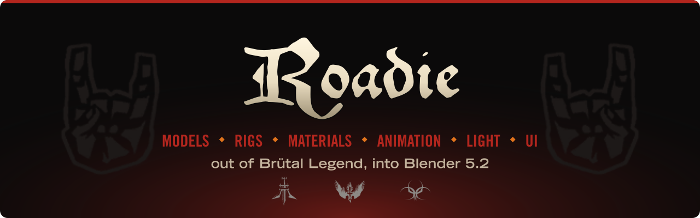
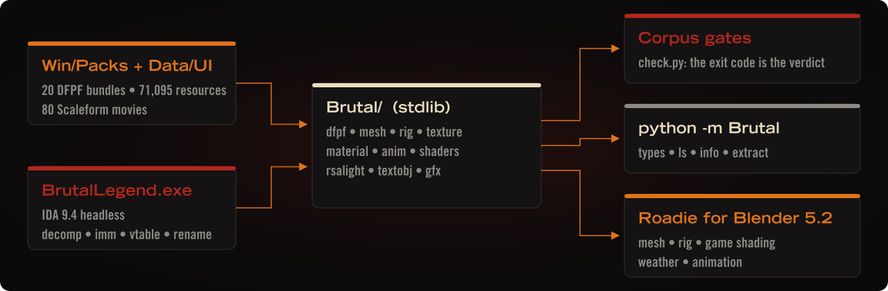
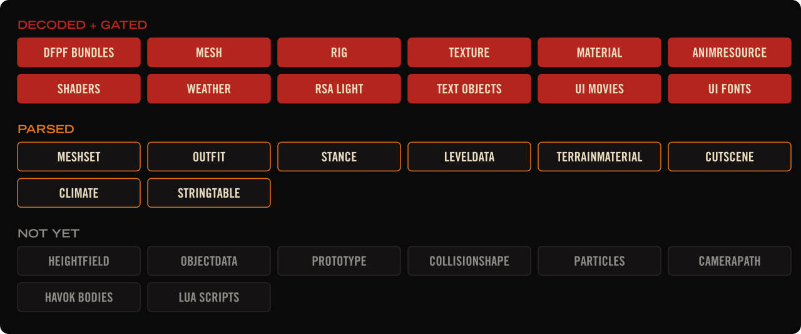

<div align="center">




[](https://github.com/JeanxPereira/Roadie/actions/workflows/ci.yml)
[](https://github.com/JeanxPereira/Roadie/releases)

</div>

## 

In the game's own legends, the First Ones lured Ormagöden, the Fire Beast, down to the earth and
tried to smother him in mud; he exploded like a sun, his blood became the oceans, and his death gave
the world the elements of a new age: Blood, Fire, Noise and Metal. The Titans mined his steel flesh
to forge their blades and hot rods. Ages later a roadie, Eddie Riggs, bleeds into a belt buckle
that is really an idol of Ormagöden and is carried back into that Age of Metal. The game's script
tables tag every one of Eddie's lines `ROAD`.

**Roadie** does a roadie's job for the game itself: it hauls Brütal Legend's resources out of the
bundles and sets them up in Blender, models, skeletons, materials, the game's own lighting, every
animation, and the UI.

## 

Each format is taken from two sources at once: the bundles in `Win/Packs` (71,095 resources) and
`BrutalLegend.exe` under IDA 9.4 headless. A field is only written down when a **corpus gate**
proves it over every resource of its type: byte budgets that close exactly, headers that match the
size the game's own packer recorded, indices that stay in range. Then it becomes a decoder in
`Blender/BrutalLegend/Brutal/`, and the Blender extension builds on the decoder.

<p align="center"></p>

## 

<p align="center"></p>

| Gate | Result |
|---|---|
| DFPF records unpack to header + data | 71,095 / 71,095 |
| Mesh byte budget closes, parsed header = packer's header size | 7,711 / 7,711 |
| Rig parses, parents precede children; mesh palettes inside rig | 302 / 302 · 301 / 301 |
| Texture → DDS byte-exact | 10,656 / 10,656 (+16 baked-light records) |
| Material parses, texture references resolve | 2,748 · 11,247 / 11,247 |
| Text objects (69 types) parse | 11,678 / 11,678 |
| Animations decode; chunks and sections close; quaternions unit | 15,866 · 34,370 · 9,857,285 |
| Morph delta scale (morphed normals stay unit) | 128,331 deltas, rms 1.3e-4 |
| Winding vs the game's stored normals (a01_avatar) | 34,413 / 34,436 |
| Shader containers parse, every material resolves to a technique | 12 · 2,748 / 2,748 |
| UI movies parse to their length, external images resolve | 80 / 80 · 1,664 / 1,664 |

## 

```sh
python check.py                    # every corpus gate (needs the game)
python check.py --blender          # + import smoke test in the pinned Blender 5.2.3
python Tools/build_addon.py        # dist/brutal_legend-<ver>.zip
python Tools/readme_art.py         # this README's art, from the game's own fonts and emblems
```

A release is a tag: bump `version` in `Blender/BrutalLegend/blender_manifest.toml`, push
`vX.Y.Z`, and the release workflow validates the extension in Blender 5.2.3, attaches the zip to a
GitHub release and republishes the extensions repository on GitHub Pages. CI runs on every push
without the game: compile, build, Blender's manifest validation and a headless install + enable.

The game path defaults to the Steam library in `Blender/BrutalLegend/Brutal/paths.py`; override with `BL_GAME_DIR`.

## 

**Install**: in Blender 5.2, *Edit › Preferences › Get Extensions › Repositories › +* (remote)
and add `https://jeanxpereira.github.io/Roadie/index.json`. Blender then installs Roadie and
offers every new release as an update. Or download `brutal_legend-<ver>.zip` from
[Releases](https://github.com/JeanxPereira/Roadie/releases) and use *Install from Disk*. Roadie
reads a Brütal Legend (PC) install; it ships no game data.

**Blender**: set the game folder in the extension preferences, then open the
**Brutal Legend** tab in the 3D view sidebar: search, pick, *Import*. Meshes come with the game's
own shading (sun, sky ramp, rim, glow, hair ramps; no PBR guesswork), the skeleton and skin
weights, and facial morphs as shape keys. *Apply Weather* lights the scene with any of the game's
146 weathers. Select an imported armature and import an *Anim* to get an action (bones + face),
or press *Import All Animations* to pull every clip made for that rig (the character's own, or
everything including cutscenes and mounts) and click through them in the sidebar list.

**Command line**

```sh
python Tools/brutal.py types
python Tools/brutal.py ls "*a01_avatar/rig/*"
python Tools/brutal.py info characters/bipeds/a01_avatar/rig/a01_avatar.Mesh
python Tools/brutal.py extract "*a01_avatar/textures/*" -t Texture -o out --convert
python Tools/brutal.py ui fonts -o fonts
python Tools/brutal.py ui render Pause -o pause.svg --label justMenu --settle
```

## 

The interface is Scaleform GFx. Each screen is a `DUIMovie` resource that names a SWF 8 movie on
disk (`Data/UI/<Screen>/Opt/<Screen>.gfx`, zlib-packed as `CFX`) and the textures it draws with.
The movies carry no pixels: every bitmap is a Scaleform external image whose file name matches a
`ui/flash/<screen>/…` Texture in the bundles. Lettering comes from one shared movie,
`EnglishFonts.gfx`, which `FlashConfig` maps to the names the screens ask for: `$Fancy` is the
blackletter **Schreibweise**, `$Menu` is **TG_Menu**, `$Condensed` is **TG_Condensed**. The banner
and headers above are set in those three fonts, decoded from that movie.
`ui fonts` writes them out as TrueType; `ui render` draws a frame of any screen to SVG with its
textures and text (scripted state aside: the game's ActionScript is not run).

At run time the game links Scaleform GFx 2.1.57 with its Direct3D 9 renderer. Movies are opened
from the bundles, not from disk, and their images are bound to the game's own textures. The
game drives a screen only by setting ActionScript variables, jumping to labeled frames and sending
key events. Screens call back through `fscommand`: four native commands (line-code text, language,
native resolution, disable) and a bridge that runs Lua (`game.*`, `profile.*`, `flash.*`) and
writes the result back into an ActionScript variable. Text keys `*<LineCode>` are replaced from
the string tables, with controller glyphs inlined from `PhysicalInputIcons`. The whole path, with
IDA addresses: [Docs/Formats/ui.md](Docs/Formats/ui.md).

## 

| What | Where |
|---|---|
| Format reference | [Docs/formats.md](Docs/formats.md), [anim](Docs/Formats/anim.md), [shaders](Docs/Formats/shaders.md), [ui](Docs/Formats/ui.md) |
| Asset roadmap | [Docs/assets.md](Docs/assets.md) |
| Decoders | `Blender/BrutalLegend/Brutal/` |
| Gates | `Tests/`, `check.py` |
| Blender extension | `Blender/BrutalLegend/` |
| IDA headless tooling | `Tools/Ida/` |

<div align="center"><sub>Made by JeanxPereira · GPL-3.0 · Brütal Legend and its lettering and emblems belong to Double Fine Productions; Roadie is a fan project and ships no game data</sub></div>
